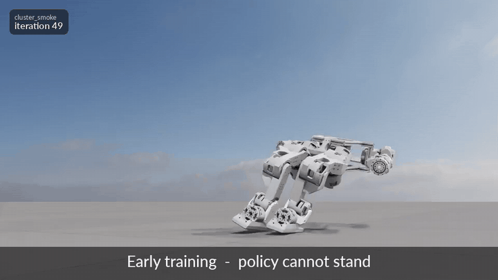

  

*Simulation only: checkpoints at iterations 49, 100, 700 and 6000, taken from successive runs of the search (labels top-left). Hardware is at bring-up stage; no real-robot walking is shown here.*

# MINA — Robust PPO Locomotion for a Low-Cost Humanoid Biped

Sole-authored EPFL Master's semester project (June 2026), supervised by
Prof. Matthieu Salzmann (Computer Vision Laboratory, CVLab).

**Paper:** [mina-locomotion.pdf](./mina-locomotion.pdf) — *"Beating the Berkeley
Baseline in Simulation: Robust PPO Locomotion for a Low-Cost Humanoid Biped."*

A PPO training recipe (RSL-RL / Isaac Lab) for robust locomotion on the 12-DoF
Berkeley Humanoid Lite, validated cross-engine (MuJoCo / Isaac Sim) — the only
policy in a 230-run / 268-hour search with zero falls across 73 MuJoCo
robustness scenarios and 90.5% push survival, beating the UC Berkeley baseline.
